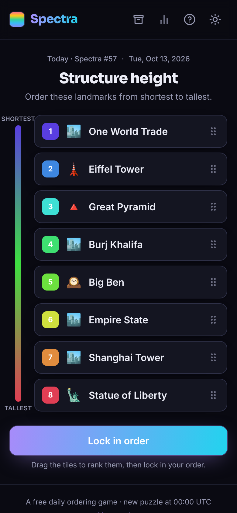
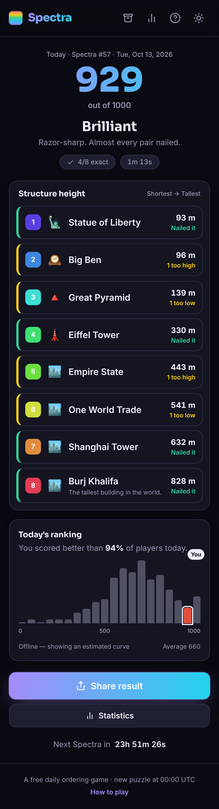
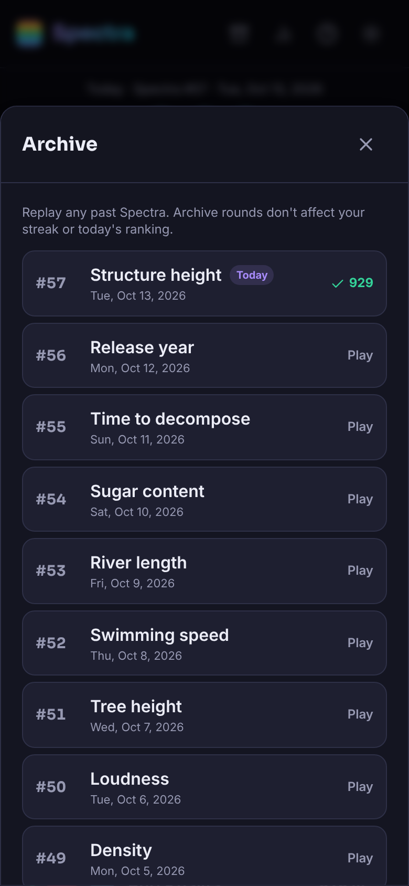

<div align="center">


# Spectra

**Eight things, one hidden gradient. Put them in order before the scale reveals the truth.**

A tiny daily game: every day you get one axis — calories, speed, year invented, bite force —
and eight things to drag into order from least to most. Lock it in and the scale lights up,
flinging each item to where it really belongs. You score points for every pair you got right,
so even a hunch pays off.

[](https://github.com/viktor-lorentz/Spectra/actions/workflows/ci.yml)
[](LICENSE)


<br />





</div>

---

## Why it's fun

Most trivia asks you to *know the exact answer*. Spectra only asks you to know **the order** —
and that's a much more forgiving, much more addictive question. Is an ostrich faster than a
greyhound? Which came first, the DVD or the iPod? You rarely know every value, but you usually
know *most* of the pairs, and the Kendall-tau score rewards exactly that. It spreads scores out
nicely, so the daily "you beat 94% of players" actually means something, and a round takes about
two minutes.

## Features

- 🎚️ **A new puzzle every day** at **00:00 UTC**, the same for everyone, with a live countdown to
  the next one. 60+ days are generated up front and the bank keeps the schedule topped up.
- 🧠 **Smooth 0–1000 scoring** via normalized Kendall-tau distance — every correctly ordered pair
  earns points, a perfect order is 1000, a fully reversed one is 0.
- 📊 **Today's ranking** — after you finish, see where you landed on a live histogram of everyone's
  scores today, powered by a free Cloudflare Worker + D1 backend. Falls back to a built-in estimate
  when you're offline.
- 📈 **Local statistics** — games played, win rate, current & max streak, average score and a
  personal score distribution, all stored on your device.
- 🗓️ **Archive** — replay any past puzzle. Archive rounds never touch your streak or the daily
  ranking.
- 🔗 **Spoiler-free sharing** — copy a Wordle-style emoji grid that shows how close you got without
  giving away the answer.
- 🌗 **Dark & light themes**, mobile-first, with micro-animations and reduced-motion support.
- 🆓 **Completely free** — no ads, no accounts, no paywalls.

## Tech stack

| | |
|---|---|
| Frontend | Vite + React 18 + TypeScript + Tailwind CSS |
| Animation | Framer Motion (drag-to-reorder + the reveal) |
| Backend | Cloudflare Worker + D1 (anonymous score aggregation) |
| Tests | Vitest |
| Hosting | Any static host — Cloudflare Pages, Netlify, Vercel or GitHub Pages |

The game is fully playable with **no backend at all** — the ranking just switches to a deterministic
offline estimate. The backend only exists to make "you beat X% of players today" real.

## Run it locally

```bash
# 1. install
npm install

# 2. (re)generate the puzzle schedule from the set bank
npm run generate

# 3. start the dev server
npm run dev          # http://localhost:5173
```

Other handy scripts:

```bash
npm test             # run the unit tests (scoring, scheduling, sharing, stats…)
npm run typecheck    # tsc --noEmit
npm run build        # production build into dist/
npm run preview      # serve the production build locally
```

Want the real ranking locally? Copy `.env.example` to `.env` and point `VITE_API_URL` at a running
worker (see below). Leave it empty to use the offline estimate.

## Deploy

### 1. The backend (Cloudflare Worker + D1) — free tier

```bash
cd worker
npm install
npx wrangler login

# create the database, then paste the printed database_id into wrangler.toml
npx wrangler d1 create spectra

# create the table
npm run db:init

# set a secret salt for the stored hashes
npx wrangler secret put SALT        # paste any long random string

# deploy
npm run deploy
```

Wrangler prints your worker URL, e.g. `https://spectra-api.<you>.workers.dev`.
For production, set `ALLOW_ORIGIN` in `wrangler.toml` to your site's origin.

**Anti-abuse built in:** one score per (day, client), a per-IP daily cap, strict range validation,
and client/IP values are only ever stored as salted SHA-256 hashes.

### 2. The frontend (static)

Set `VITE_API_URL` to your worker URL, then deploy `dist/` anywhere. Examples:

- **Cloudflare Pages / Netlify / Vercel** — framework preset "Vite", build `npm run build`, output
  `dist`, and add the env var `VITE_API_URL`.
- **GitHub Pages** — this repo includes `.github/workflows/deploy-pages.yml`. Enable Pages
  (Settings → Pages → Source: GitHub Actions) and push to `main`. Add `VITE_API_URL` as a repo
  variable if you want live rankings.

## Adding more puzzles

All the content lives in one file: [`src/data/sets.json`](src/data/sets.json). Each entry is one
axis and its eight items:

```jsonc
{
  "id": "animal-landspeed",          // unique, stable slug
  "axis": "Land speed",              // shown as the title
  "prompt": "Order these animals from slowest to fastest on land.",
  "unit": "km/h",                    // appended to revealed values ("" for none)
  "lowLabel": "Slowest",
  "highLabel": "Fastest",
  "category": "animals",
  "format": "integer",               // "integer" | "number" | "year"
  "items": [
    { "name": "Hippo", "value": 30, "emoji": "🦛" },
    { "name": "Cheetah", "value": 112, "emoji": "🐆", "note": "Optional fun fact." }
    // …exactly 8, each with a DISTINCT value
  ]
}
```

Then regenerate the schedule:

```bash
npm run generate        # appends new future days; already-published dates never change
```

The generator **validates** every set (exactly 8 items, strictly distinct values) and lays future
days out as shuffled passes of the whole bank, so sets are spaced out and nothing published is ever
rewritten. Use `npm run generate:fresh` to rebuild the schedule from scratch (do this only before
launch).

> Ordering is graded on **relative order**, so exact values can be approximate — what matters is
> that the eight values sort into the intended order.

## How scoring works

Your order is compared to the true order with **normalized Kendall-tau**: with 8 items there are
28 pairs, and your score is `1000 × (concordant pairs ÷ 28)`. Get every pair right → 1000; reverse
everything → 0. The share grid marks each slot: 🟩 exact, 🟨 off by one, ⬛ further out.

## Project structure

```
src/
  data/        sets.json (the content) + generated puzzles.json (the schedule)
  lib/         scoring, daily scheduling, stats, ranking, sharing, formatting
  hooks/       useGame, useCountdown, useTheme
  components/  board, reveal, modals, charts…
scripts/       generate-puzzles.mjs
worker/        Cloudflare Worker + D1 backend
```

## License

MIT — see [LICENSE](LICENSE).
